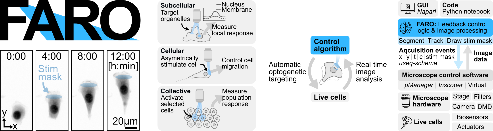

# FARO: Real-time feedback control microscopy for automation of optogenetic targeting
**FARO** (**F**eedback **A**daptive **R**eal-time **O**ptogenetics, also *lighthouse* in Spanish) acquires images, segments cells, extracts features, tracks them over time, and generates stimulation masks, all while the experiment is running. This enables closed-loop feedback control: stimulation patterns can be computed from the latest segmentation and applied within the same or next timepoint.



## Architecture

```
Pipeline   <-->  Controller   <-->   Microscope
--------         ----------          ----------
- segment        - orchestrate       - stage
- track            experiment        - camera
- extract                            - DMD/SLM
  features                           - live cells
- stim mask
```
**Microscope**: hardware interface. Any microscope that implements [useq-schema](https://github.com/pymmcore-plus/useq-schema) can be used. Works great with Micro-Manager / [pymmcore-plus](https://github.com/pymmcore-plus/pymmcore-plus).

**Pipeline**: modular image processing. Performs segmentation, tracking, feature extraction. Decides if/where to photoactivate the sample.

**Controller**: experiment orchestrator. Queues acquisition events to the microscope, dispatches frames to the pipeline, and coordinates stimulation timing. A simulated controller (`ControllerSimulated`) can replay pre-acquired data from disk for testing or re-analysis.

## Quickstart

Run [`examples/live_experiment.ipynb`](examples/live_experiment.ipynb) for a complete optogenetic feedback experiment on a virtual microscope. No hardware needed.

```python
# 1. Set microscope
mic = UniMMCoreSimulation(mmc=mmc)
mic.init_scope()
mic.calibrate_dmd("Cyan")   # scopes with a DMD: once per session, on an empty field

# 2. Assemble image processing pipeline
pipeline = ImageProcessingPipeline(
    storage_path="/path/to/experiment",
    segmentators=[SegmentationMethod("labels", OtsuSegmentator(), use_channel=0, save_tracked=True)],
    feature_extractor=SimpleFE("labels"),
    tracker=TrackerTrackpy(),
    stimulator=StimWholeFOV(),  # or your own, see Writing your own components
)

# 3. Define experiment parameters
events = RTMSequence(
    time_plan={"interval": 5.0, "loops": 20},
    stage_positions=[{"x": 256, "y": 256}],
    channels=[{"config": "BF", "exposure": 50}],
    stim_channels=[{"config": "Cyan", "exposure": 50}],
    stim_frames=range(5, 20),
)

# 4. Run!
ctrl = Controller(mic, pipeline)
handle = ctrl.run_experiment(list(events), stim_mode="current")
handle.wait()  # run_experiment is non-blocking; wait() blocks until done
```

## Examples and templates

| Path | What it is |
|------|------------|
| [`examples/live_experiment.ipynb`](examples/live_experiment.ipynb) | A full feedback experiment on a virtual microscope: the four objects, custom pipeline components, three phases, napari GUI, result plots. |
| [`templates/live_experiment/`](templates/live_experiment/) | Copy-and-fill folder for a real experiment: notebook with TODO cells that runs on the virtual microscope as shipped, plus a `pyproject.toml` that pins faro. |
| [`templates/reanalysis/`](templates/reanalysis/) | Copy-and-fill folder to re-process an experiment that is already on disk. |
| [`templates/README.md`](templates/README.md) | How to copy a template, `uv sync`, pin faro to a commit, update the pin, and work against a local checkout. |

The virtual microscope ([virtual-microscope-teaching](https://github.com/hinderling/virtual-microscope-teaching), a small pure-Python simulator of light-responsive cells behind the pymmcore-plus API) is part of the base install, so the example and the templates run right after `uv sync`. The test suite executes them on it, so they always match the code. Real experiments live in the separate [faro-experiments](https://github.com/pertzlab/faro-experiments) repository: one folder per experiment, each pinned to a faro commit.

## Pipeline

The pipeline is modular, each component is independent and can be swapped or set to `None`.

| Component | Purpose | Examples |
|-----------|---------|----------|
| **Segmentation** | Identify cells in images | `OtsuSegmentator`, `SegmentorCellpose`, `SegmentatorStardist`, remote via [imaging-server-kit](https://github.com/imaging-server-kit) |
| **Stimulation** | Generate masks for DMD/SLM | `StimWholeFOV`, `StimPercentageOfCell`, `CenterCircle`, `StimLine` |
| **Feature extraction** | Measure cell properties | `SimpleFE` (position, area), `FE_ErkKtr` (ERK-KTR c/n ratio) |
| **Tracking** | Link cells across frames | `TrackerTrackpy` (via [trackpy](https://github.com/soft-matter/trackpy)), `TrackerMotile` (ILP via [motile](https://github.com/funkelab/motile), supports divisions/merges) |

```python
pipeline = ImageProcessingPipeline(
    storage_path="/path/to/experiment",
    segmentators=segmentators,  # list of SegmentationMethod
    feature_extractor=fe,
    tracker=tracker,
    stimulator=stimulator,
    feature_extractor_ref=ref_fe,  # optional: for reference acquisition frames
)
```

## Writing your own components

Every component is a small class with one method. The pipeline calls that method once per frame and merges the result. `validate_events` compares your method signature with the base class before a run starts, so keep the argument names. The [live experiment example](examples/live_experiment.ipynb) implements one of each.

### Segmentator

```python
import numpy as np
from faro.segmentation.base import Segmentator

class MySegmentator(Segmentator):
    def segment(self, image: np.ndarray) -> np.ndarray:
        # image: (y, x) for use_channel=int, or (c, y, x) for use_channel=list
        # return: integer label image, same (y, x) shape, 0 = background
        ...
```

Register it under a name: `SegmentationMethod("labels", MySegmentator(), use_channel=0, save_tracked=True)`. Several methods can run on the same frame, for example nuclei and whole cells. Other components refer to a segmentation by its name.

### Tracker

```python
import pandas as pd
from faro.tracking.base import Tracker

class MyTracker(Tracker):
    def track_cells(self, df_old: pd.DataFrame, df_new: pd.DataFrame, fov_state) -> pd.DataFrame:
        # df_old: all rows tracked so far for this field of view
        # df_new: this frame's detections with columns label, x, y
        # fov_state: per-FOV scratch space that survives between frames
        # return: df_old plus df_new, every row with a "particle" id
        ...
```

`TrackerTrackpy` and `TrackerMotile` cover most needs. Write your own only if you need a different linking model.

### FeatureExtractor

```python
import pandas as pd
from skimage.measure import regionprops_table
from faro.feature_extraction.base import FeatureExtractor

class MyFE(FeatureExtractor):
    def __init__(self, used_mask: str):
        self.used_mask = used_mask     # name of the segmentation to measure
        super().__init__()

    def extract_features(self, labels: dict, image, df_tracked=None, metadata=None):
        # labels: {segmentation name: label image}
        # image: (c, y, x) stack of the imaging channels
        # return: (DataFrame with a "label" column plus your features, None)
        table = regionprops_table(labels[self.used_mask], intensity_image=image[0],
                                  properties=["label", "area", "mean_intensity"])
        return pd.DataFrame(table), None
```

The pipeline joins the returned columns onto the tracks by `label`. The second return value is reserved for masks that a reference-frame extractor needs; return `None` unless you use reference acquisitions.

### Stimulator

Pick the base class by what the decision needs:

| Base class | `get_stim_mask` receives |
|------------|--------------------------|
| `Stim` | `metadata` only (`img_shape`, `timestep`, `fov`, your `rtm_metadata`) |
| `StimWithImage` | `metadata`, `img` |
| `StimWithPipeline` | `label_images`, `metadata`, `img`, `tracks` |

```python
import numpy as np
from faro.stimulation.base import StimWithPipeline

class MyStim(StimWithPipeline):
    required_metadata = {"stim_fraction"}   # keys that must be in rtm_metadata

    def get_stim_mask(self, label_images, metadata=None, img=None, tracks=None):
        # return: (uint8 mask of shape metadata["img_shape"], anything you want logged)
        mask = np.zeros(metadata["img_shape"], dtype=np.uint8)
        ...
        return mask, None
```

`tracks` holds the tracked DataFrame up to the current frame, so a stimulator can treat cells differently by `particle` id or by a feature value. Return `True` instead of a mask to illuminate the whole field of view.

## Controller

The Controller converts RTMEvents to MDAEvents, queues them through the microscope, and dispatches frames to the pipeline.

### Experiment Definition

Experiments are defined as `RTMSequence` objects, an extension of useq's `MDASequence`. Compose multi-step experiments with `combine()`, which supports two modes of composition via the `axis` argument:

```python
from faro.core.data_structures import Channel, PowerChannel, RTMSequence, combine
```

**Sequential phases (`axis="t"`).** Each phase runs after the previous one, same positions, with `t` indices and wall-clock times offset automatically:

```python
baseline = RTMSequence(
    time_plan={"interval": 60.0, "loops": 100},
    stage_positions=fov_positions,
    channels=[{"config": "miRFP", "exposure": 300}],
)
treatment = RTMSequence(
    time_plan={"interval": 60.0, "loops": 150},
    stage_positions=fov_positions,
    channels=[{"config": "miRFP", "exposure": 300}],
)
washout = RTMSequence(...)

events = combine(baseline, treatment, washout, axis="t")
```

**Parallel sub-experiments (`axis="p"`).** Two (or more) setups running concurrently on different subsets of FOVs. This is useful when FOVs need different stim patterns, different stim schedules, or different treatment metadata, but should share the clock. Each sub-experiment keeps its own `stim_frames` and `rtm_metadata`:

```python
setup_a = RTMSequence(
    time_plan={"interval": 10.0, "loops": 100},
    stage_positions=fovs_1_to_5,
    channels=[{"config": "miRFP", "exposure": 300}],
    stim_channels=(stim_pattern_a,),
    stim_frames={10, 20, 30},
    rtm_metadata={"treatment": "DMSO"},
)
setup_b = RTMSequence(
    time_plan={"interval": 10.0, "loops": 100},
    stage_positions=fovs_6_to_10,
    channels=[{"config": "miRFP", "exposure": 300}],  # must match setup_a
    stim_channels=(stim_pattern_b,),
    stim_frames={15, 25, 35},
    rtm_metadata={"treatment": "drug"},
)

events = combine(setup_a, setup_b, axis="p")
# At each timepoint: FOVs 0-4 image with setup_a's stim schedule,
# FOVs 5-9 image with setup_b's, all in parallel on the same clock.
```

**Precondition for `axis="p"`:** all sub-experiments must declare the same imaging channels. The writer allocates a single channel set across all positions, so heterogeneous channels per FOV are not supported today (tracked for the eventual useq-schema v2 migration). A `ValueError` is raised at call time if channel configs differ.

`combine()` is variadic (`combine(a, b, c, d, ..., axis=...)`), handles the N=0 and N=1 degenerate cases, and is the only composition primitive. There is deliberately no shorthand operator, so every multi-step experiment reads the composition axis explicitly.

**Timed waits between phases.** `wait(seconds)` inserts a fixed-duration pause, for example to let cells recover before stimulating. It acquires no frames and just delays everything after it:

```python
from faro.core.data_structures import wait

events = combine(baseline, wait(60), stim_phase, axis="t")
```

### Stimulation

Stimulation channels are acquired on specific frames, controlled via DMD/SLM. Define them with `stim_channels` and `stim_frames`:

```python
seq = RTMSequence(
    time_plan={"interval": 5.0, "loops": 50},
    stage_positions=fov_positions,
    channels=[{"config": "miRFP", "exposure": 300}],
    stim_channels=(PowerChannel(config="CyanStim", exposure=200, power=10),),
    stim_frames=range(10, 50),
)
```

**Stimulation modes** (set via `ctrl.run_experiment(events, stim_mode=...)`):
* `"current"`: acquire frame, wait for segmentation mask, then stimulate in the same timepoint
* `"previous"`: stimulate using the mask from the previous timepoint, then acquire

### Reference Acquisition

Reference channels are acquired on specific frames for one-time measurements whose features are broadcast to all timepoints, for example checking expression of an optogenetic tool, or a high-resolution image that would bleach the sample. Define them with `ref_channels` and `ref_frames`:

```python
seq = RTMSequence(
    time_plan={"interval": 5.0, "loops": 50},
    stage_positions=fov_positions,
    channels=[{"config": "miRFP", "exposure": 300}],
    ref_channels=(Channel(config="mCitrine", exposure=600),),
    ref_frames={-1},  # last frame only
)
```

Alternatively, define the reference as a separate phase and chain it with `combine`:

```python
experiment = RTMSequence(time_plan=..., channels=..., ...)
ref_phase  = RTMSequence(
    time_plan={"interval": 0, "loops": 1},
    stage_positions=fov_positions,
    channels=[{"config": "mCitrine", "exposure": 600}],
    rtm_metadata={"img_type": ImgType.IMG_REF},
)
events = combine(experiment, ref_phase, axis="t")
```

`RefFE` measures only one reference channel: one entry in `ref_channels`, or a ref phase with one channel (all channels of a ref phase are the reference). For more channels, subclass `RefFE` and pass it one channel, e.g. `image[-1:]`.

### Frame Specification

Both `stim_frames` and `ref_frames` accept:
* **Sets**: `{0, 5, 10}` for specific frames
* **Ranges**: `range(10, 50)` or `range(0, 50, 2)` for contiguous or strided frames
* **Negative indices**: `-1` = last frame, `-2` = second-to-last

### Axis Order

`axis_order` controls the nesting of time, position, and channel dimensions (inherited from useq's `MDASequence`). The default is `"tpcz"`:

| `axis_order` | Iteration | Use case |
|---|---|---|
| `"tpcz"` (default) | All positions at t=0, then all at t=1, ... | Maximize temporal resolution per position |
| `"ptcz"` | All timepoints at p=0, then all at p=1, ... | Complete one position before moving to the next |

```python
# Visit all 3 positions at each timepoint before advancing
seq = RTMSequence(
    time_plan={"interval": 5.0, "loops": 50},
    stage_positions=[(0, 0, 0), (100, 100, 0), (200, 200, 0)],
    channels=[{"config": "BF", "exposure": 50}],
    axis_order="tpcz",  # default: (t=0,p=0), (t=0,p=1), (t=0,p=2), (t=1,p=0), ...
)

# Complete all timepoints at each position before moving on
seq = RTMSequence(
    ...,
    axis_order="ptcz",  # (t=0,p=0), (t=1,p=0), ..., (t=49,p=0), (t=0,p=1), ...
)
```

Stimulation and reference channels are assigned per-timepoint, so they work correctly regardless of axis order. For example, `stim_frames={3}` stimulates all positions at t=3, whether they are visited consecutively (`tpcz`) or spread across the run (`ptcz`).

### FOV Batching

When an experiment has more FOV positions than can be imaged within a single timepoint interval, FOV batching automatically partitions positions into sequential batches with adjusted timing.

```python
from faro.core.utils import check_fov_batching, apply_fov_batching

events = list(seq)

# Check whether all FOVs fit in one batch
check_fov_batching(events, time_per_fov=2.0)

# If not, split into batches with adjusted timing
events = apply_fov_batching(events, time_per_fov=2.0)
```

`check_fov_batching` computes how many FOVs fit in parallel (`interval / time_per_fov`) and reports whether batching is needed. `apply_fov_batching` offsets overflow FOVs into subsequent batches so that each batch runs within the interval. Timepoint indices are adjusted so the imaging order remains physically sensible.

### Running

```python
from faro.core.controller import Controller

ctrl = Controller(mic, pipeline)
handle = ctrl.run_experiment(events, stim_mode="current")
handle.wait()  # block until the run finishes
```

### Validation

`ctrl.validate_events(events)` runs before every experiment (`validate=False` skips it) and returns `False` with one warning per problem. Fix every warning before you start. It checks:

- **Signatures**: each segmentator, tracker, feature extractor and stimulator accepts the arguments of its base-class method.
- **Required metadata**: every key a component lists in `required_metadata` is present in the event metadata (`rtm_metadata`).
- **Phases**: events with `phase_name` also carry `phase_id`, which names the per-phase tracks file.
- **Channels**: every imaging and stimulation config exists in a Micro-Manager config group.
- **Exposure**: within the camera's limits.
- **Power**: `PowerChannel.power` within the range of the device property.
- **DMD**: calibrated whenever the events contain stimulation channels.

`run_experiment()` and `continue_experiment()` are **non-blocking**: they return a `RunHandle` so the kernel stays free (e.g. to use the napari viewer). Call `handle.wait()` to block until the run finishes.

```python
handle = ctrl.run_experiment(events, stim_mode="current")
handle.pause(); handle.resume()   # stop/resume acquiring; schedule is preserved
handle.cancel()                   # graceful stop
handle.wait()                     # block until done

# Live status badge, progress strip, and Pause/Start/Stop buttons in napari:
from faro.widgets import ExperimentStatusWidget
status_wdg = ExperimentStatusWidget(ctrl)   # or ExperimentStatusWidget()
viewer.window.add_dock_widget(status_wdg, area="right")
status_wdg.set_controller(new_ctrl)         # reusable: swap controllers at runtime
```

Instead of starting immediately with `run_experiment`, you can **stage** an experiment first: `ctrl.load_experiment(events, stim_mode="current")` validates the events and previews the plan in the status widget (event strip, FOV map, planned duration) without acquiring anything. The widget's button reads **Start** while staged. Press it, or call `ctrl.start_experiment()`, to begin the run; the button then flips back to **Stop**.

### Experiment Continuation

Call `run_experiment()` once, then `continue_experiment()` to append more phases. The Analyzer (and all per-FOV tracking state) is reused, so timesteps, filenames, and particle IDs continue seamlessly.

```python
ctrl = Controller(mic, pipeline)

# Phase 1: baseline. Find cells, measure growth rate
phase1 = RTMSequence(time_plan={"interval": 10, "loops": 60}, ...)
ctrl.run_experiment(phase1, validate=False).wait()  # wait() before reading results

# Analyse phase-1 results to decide what to do next
df = pd.read_parquet("tracks/000_latest.parquet")
fast_growers = df.groupby("particle")["area"].apply(lambda x: x.diff().mean())

# Phase 2: stimulate based on analysis
phase2 = RTMSequence(time_plan={"interval": 10, "loops": 120}, ...)
ctrl.continue_experiment(phase2).wait()

# Always call finish_experiment() when done
ctrl.finish_experiment()
```

To add events while an experiment is still running, use `extend_experiment()`:

```python
ctrl.run_experiment(baseline_events, validate=False)  # runs in background thread
ctrl.extend_experiment(extra_events)                   # non-blocking, appends to running acquisition
```

| Method | When to use | Returns |
|--------|-------------|---------|
| `run_experiment()` | First acquisition, creates a fresh Analyzer | `RunHandle` (non-blocking) |
| `continue_experiment()` | Subsequent phases, reuses Analyzer, offsets timesteps | `RunHandle` (non-blocking) |
| `extend_experiment()` | Mid-run additions, pushes events into the running loop | None (non-blocking) |
| `finish_experiment()` | Cleanup, shuts down Analyzer, resets state | None (blocks until drained) |

## Simulated Controller

`ControllerSimulated` loads pre-acquired images from disk instead of from the camera, enabling testing and re-analysis without hardware.

It supports both **TIFF** (`raw/`, `ref/` folders) and **OME-Zarr** (`acquisition.ome.zarr`) source layouts. When an OME-Zarr store is found, raw frames are read from zarr; reference images fall back to TIFFs in `ref/`.

```python
from faro.core.controller import ControllerSimulated

ctrl = ControllerSimulated(mic, pipeline, old_data_project_path="/path/to/old_experiment")
ctrl.run_experiment(events, stim_mode="current").wait()
```

Use cases:
- **Testing**: run the full pipeline on previously acquired data without any microscope hardware
- **Re-analysis**: replay raw images through a new pipeline (different segmentation, tracking, etc.)
- **Validation**: verify analysis logic reproducibly on known data

For re-processing without hardware, see [Re-analysis](#re-analysis) below.

## Re-analysis

The offline re-analysis pipeline (`ImageProcessingPipeline_postExperiment`) reprocesses images from a previous experiment with new segmentation, tracking, or feature extraction parameters, without re-acquiring.

```python
from faro.core.pipeline_post import ImageProcessingPipeline_postExperiment

pipeline = ImageProcessingPipeline_postExperiment(
    img_storage_path="/path/to/original_experiment",
    out_path="/path/to/new_output",
    events=events,
    segmentators=[SegmentationMethod("labels", SegmentorCellpose(), use_channel=0)],
    feature_extractor=FE_ErkKtr("labels"),
    tracker=TrackerTrackpy(),
    n_jobs=4,
)
pipeline.run()
```

Key features:
- **Dual input format**: reads from both TIFF and OME-Zarr source experiments
- **Reuse old segmentations**: set `use_old_segmentations=True` to skip re-segmenting and only recompute tracking/features
- **Parallel FOV processing**: uses `n_jobs` threads to process multiple FOVs concurrently
- **Hard-linking**: when outputting to OME-Zarr, raw data resolution levels are hard-linked instead of copied (falls back to copy on network shares). OME-Zarr output therefore needs an OME-Zarr source; for a TIFF source, pass `writer=TiffWriter(out_path)`
- **Timestep gap correction**: `correct_timestep_jumps=True` backfills missing timesteps

The [re-analysis template](templates/reanalysis/) is a copy-and-fill notebook for this pipeline.

## Storage

The pipeline writes acquired images, segmentation masks, and stimulation masks to disk. Three writer backends are available:

| Writer | Format | Best for |
|--------|--------|----------|
| `TiffWriter` | Individual TIFF files | Quick inspection, legacy compatibility |
| `OmeZarrWriter` | OME-Zarr v0.5 | Streaming acquisition, cloud-friendly, single multi-dimensional array |
| `OmeZarrWriterPlate` | OME-Zarr v0.5 (plate layout) | Multi-position experiments viewed as a spatial mosaic |

### OmeZarrWriter (default)


Streams all data into a single OME-Zarr v0.5 store. Raw images are stored as a single multi-dimensional array (t, c, y, x) for single-position experiments or (t, p, c, y, x) for multi-position experiments. Segmentation labels are stored as NGFF label groups.

```
experiment/
├── acquisition.ome.zarr/
│   ├── 0/                  raw data array
│   └── labels/
│       ├── labels/         segmentation masks
│       └── stim_mask/      stimulation masks
└── tracks/                 parquet files
```

```python
from faro.core.writers import OmeZarrWriter

writer = OmeZarrWriter(
    storage_path="/path/to/experiment",
    dtype="uint16",
    store_stim_images=False,       # True: include stim channels in raw array
    n_timepoints=None,             # None = unbounded (resizable)
    raw_chunk_t=1,                 # temporal chunk size for raw data
    label_shard_t=50,              # temporal shard size for labels
)

pipeline = ImageProcessingPipeline(
    storage_path="/path/to/experiment",
    writer=writer,
    ...
)
```

The stream is initialized automatically by the Controller before the first frame is written. No manual setup is required.

### OmeZarrWriterPlate (plate layout)

Stores each FOV position as a separate well in an OME-Zarr plate. When opened in napari with `napari-ome-zarr`, positions are tiled spatially as a mosaic rather than stacked along a position slider. This makes it easy to get an overview of all positions at once.

```
experiment/
├── acquisition.ome.zarr/
│   ├── A/
│   │   ├── 1/             well for position 0
│   │   │   └── 0/         image group (t, c, y, x)
│   │   ├── 2/             well for position 1
│   │   └── ...
└── tracks/
```

```python
from faro.core.writers import OmeZarrWriterPlate

writer = OmeZarrWriterPlate(
    storage_path="/path/to/experiment",
    dtype="uint16",
)

pipeline = ImageProcessingPipeline(
    storage_path="/path/to/experiment",
    writer=writer,
    ...
)
```

### TiffWriter
Saves each frame as a separate compressed TIFF file:

```
experiment/
├── raw/          000_000.tiff, 000_001.tiff, ...
├── labels/       000_000.tiff, ...
├── stim_mask/    ...
└── tracks/       000_latest.parquet, ...
```

```python
from faro.core.writers import TiffWriter

pipeline = ImageProcessingPipeline(
    storage_path="/path/to/experiment",
    writer=TiffWriter("/path/to/experiment"),
    ...
)
```


### Viewing OME-Zarr Data

OME-Zarr files can be viewed with [napari](https://napari.org) using the [napari-ome-zarr](https://github.com/ome/napari-ome-zarr) plugin. The easiest way to install napari as a standalone tool is with `uv tool`:

```bash
uv tool install napari[pyqt6] --with napari-ome-zarr
```

This makes `napari` available as a global command. Open an OME-Zarr dataset directly from the terminal:

```bash
napari /path/to/experiment/acquisition.ome.zarr
```

You can also create a desktop shortcut pointing to the `napari` executable for quick access. To find its location:

```bash
uv tool dir
```

### Converting TIFF to OME-Zarr

Existing TIFF-based experiments can be migrated to OME-Zarr using the conversion utility:

```python
from faro.core.conversion import convert_tiff_to_omezarr

convert_tiff_to_omezarr(
    src_path="/path/to/tiff_experiment",
    dst_path="/path/to/omezarr_experiment",
)
```

## Microscope

The microscope provides the hardware interface. Any microscope that implements the useq-schema MDA protocol can be used, the Controller never depends on pymmcore-plus directly.

### Class Hierarchy

```
AbstractMicroscope                # useq MDA interface
  ├─ PyMMCoreMicroscope           # implements via pymmcore-plus / CMMCorePlus
  │    ├─ MMDemo                  # Micro-Manager demo hardware
  │    ├─ UniMMCoreSimulation     # simulated microscope
  │    ├─ PymmcoreProxyMic        # remote via pymmcore-proxy
  │    └─ pertzlab/
  │         ├─ Jungfrau
  │         ├─ Moench
  │         └─ Niesen
  └─ InscoperMicroscope           # implements via Inscoper SDK (planned)
```

### Interface

| Method | Purpose |
|--------|---------|
| `run_mda(event_iter)` | Start MDA acquisition, returns thread handle |
| `connect_frame(callback)` | Connect frameReady: `callback(img, event)` |
| `disconnect_frame(callback)` | Disconnect frameReady |
| `cancel_mda()` | Cancel running MDA |
| `resolve_group(config_name)` | Return channel group for a config name (optional) |
| `resolve_power(channel)` | Return `(device, property, power)` (optional) |
| `validate_hardware(events)` | Check events against hardware limits (optional) |
| `init_scope()` | Load config, set up hardware |
| `post_experiment()` | Cleanup after experiment |

`PyMMCoreMicroscope` implements the MDA methods via `CMMCorePlus`. Concrete subclasses typically only need `init_scope()`.

## Micro-Manager / pymmcore-plus

The `PyMMCoreMicroscope` branch uses [pymmcore-plus](https://github.com/pymmcore-plus/pymmcore-plus) as its hardware layer. Each microscope needs a **Micro-Manager configuration file** with:

* Channel presets for each fluorophore (e.g., `GFP`, `mCherry`, `miRFP`)
* A `System > Startup` preset for initial hardware configuration
* Device properties for cameras, light sources, filter wheels, etc.

For microscopes with controllable light source power, define a `POWER_PROPERTIES` mapping so `PowerChannel` objects resolve to the correct device:

```python
POWER_PROPERTIES = {
    "CyanStim": ("Spectra", "Cyan_Level"),  # config_name -> (device, property)
}
```

## Adding Your Own Micro-Manager Microscope

Create a new file in `faro/microscope/` and inherit from `PyMMCoreMicroscope`:

```python
import pymmcore_plus
from faro.microscope.pymmcore import PyMMCoreMicroscope

class MyScope(PyMMCoreMicroscope):
    MICROMANAGER_PATH = "C:\\Program Files\\Micro-Manager-2.0"
    MICROMANAGER_CONFIG = "path/to/config.cfg"
    CHANNEL_GROUP = "Channel"

    def __init__(self):
        super().__init__()
        pymmcore_plus.use_micromanager(self.MICROMANAGER_PATH)
        self.mmc = pymmcore_plus.CMMCorePlus()
        self.init_scope()

    def init_scope(self):
        self.mmc.loadSystemConfiguration(self.MICROMANAGER_CONFIG)
        self.mmc.setChannelGroup(channelGroup=self.CHANNEL_GROUP)

    def post_experiment(self):
        pass  # optional cleanup
```

For DMD support, set up `self.dmd` in `__init__()`, see `pertzlab/moench.py` for an example.

## Installation

This project uses [uv](https://docs.astral.sh/uv/) for dependency management.

```bash
git clone https://github.com/pertzlab/faro.git
cd faro
uv sync
uv run --no-sync --with jupyterlab jupyter lab examples/live_experiment.ipynb
```

The second line opens the [example notebook](examples/live_experiment.ipynb) in Jupyter (VS Code with the `.venv` interpreter works as well). It runs on the bundled virtual microscope, so no hardware or Micro-Manager install is needed. For your own experiments, start from a [template](templates/) instead of working inside this repository.

### Extras

Optional dependency groups are available for segmentation backends and testing:

| Extra | Packages | Use case |
|-------|----------|----------|
| `cellpose` | cellpose, torch | Cellpose segmentation |
| `stardist` | stardist, tensorflow, csbdeep | StarDist segmentation |
| `convpaint` | napari-convpaint, scipy | ConvPaint segmentation |
| `test` | pytest, nbclient, motile | Run the test suite, including the notebook tests. |

Install one or more extras with `uv sync`:

```bash
uv sync --extra cellpose
uv sync --extra cellpose --extra stardist
uv sync --extra test
```

Alternatively, with pip (installs the package with all its dependencies):

```bash
pip install ".[cellpose]"
pip install ".[cellpose,stardist]"
```

## Contributing

Contributions are welcome. Please submit pull requests or open issues.

## License

MIT License. See `LICENSE` for details.
